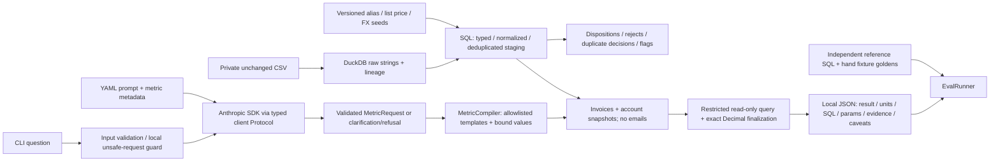

# Architecture

The implementation is a local CLI with a versioned DuckDB artifact. Customer rows
stay local. Anthropic supplies structured interpretations; Python validates them
and compiles deterministic SQL. No model-generated SQL, API server, cache, vector
store or frontend is involved.

| Package | Responsibility |
|---|---|
| `app/domain/` | Frozen contracts, enums, exception hierarchy |
| `app/pipeline/` | Ingestion, SQL execution, validation, locking and atomic publication |
| `app/metrics/` | Metric catalog, request validation, compiler and exact answers |
| `app/agent/` | YAML loader, typed client Protocol/Anthropic adapter, service |
| `app/evaluation/` | Fixtures, cases, independent reference comparison and scoring |
| `app/infrastructure/` | Restricted database connections, deadlines, structured logs |
| `app/config.py` | Flat uppercase constants plus immutable validated Settings |
| `app/cli.py`, `__main__.py` | Thin dispatch and local serialization |

`sql/transform.sql` owns set-based transformations. Python validates CSV structure;
DuckDB bulk-loads original text with record ordinality and hashes. No DataFrame row
loop cleans or models data. Prices, FX and aliases come from `seeds/`. The builder
hashes source/rules/code/SQL/seeds/prompt/lock/reference date, validates a temporary
artifact, closes it and atomically replaces the prior build under a bounded
`fcntl` lock. A source/rule change during a build aborts it.

Query connections disable external access and extension installation/loading,
lock configuration, and bound memory/threads. The compiler alone chooses tables.
DuckDB has no table-level ACL here: an authorized local Python process with file
access can inspect raw data directly; the agent has no arbitrary-query route.
Deadlines interrupt SQL; cleanup closes connections. Averages/rates use exact SQL
numerators/denominators and local Decimal division/ranking, because DuckDB decimal
division produces floating-point values.

Docker packages the same CLI under a non-root user. Only code/rules/seeds enter
the build context; the source is mounted read-only and databases use a writable
volume. No image publication or cloud deployment is performed.
