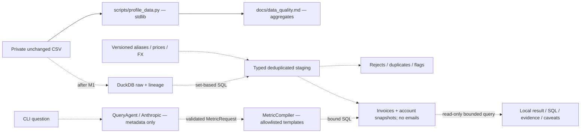

# Architecture and implementation state

At M1 only the solid profiling path below exists. No DuckDB artifact, app, agent,
evaluation harness or Anthropic integration has been built. The dashed paths
are specified future work, contingent on M1 approval.

Planned module boundaries: `app/config.py`, `models.py`, `errors.py`,
`pipeline.py`, `metrics.py`, `agent.py`, `cli.py`, `evaluations.py`, with SQL in
`sql/`, seeds in `seeds/`, fixtures/reference SQL/case definitions in `evals/`.
Entry points remain thin. The builder owns writable connections and artifact
replacement; query execution opens short-lived restricted read-only connections.
No frontend, vector store, deployment, API, cache or speculative infrastructure.
